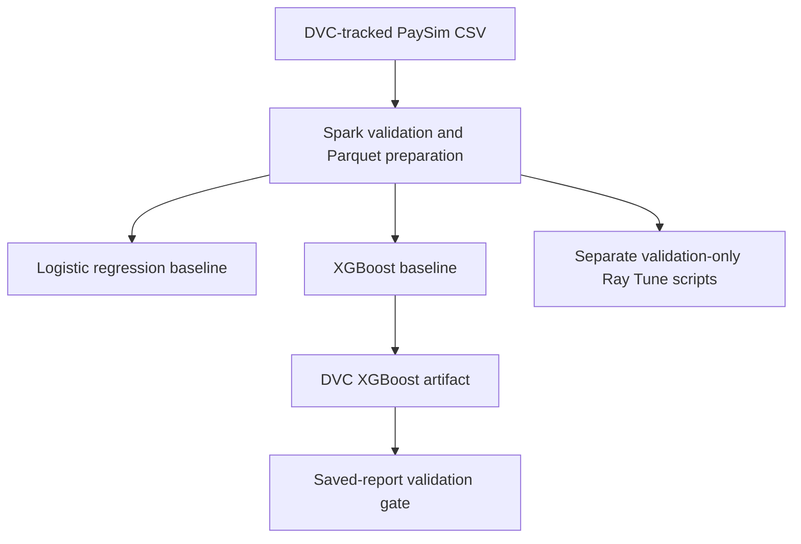
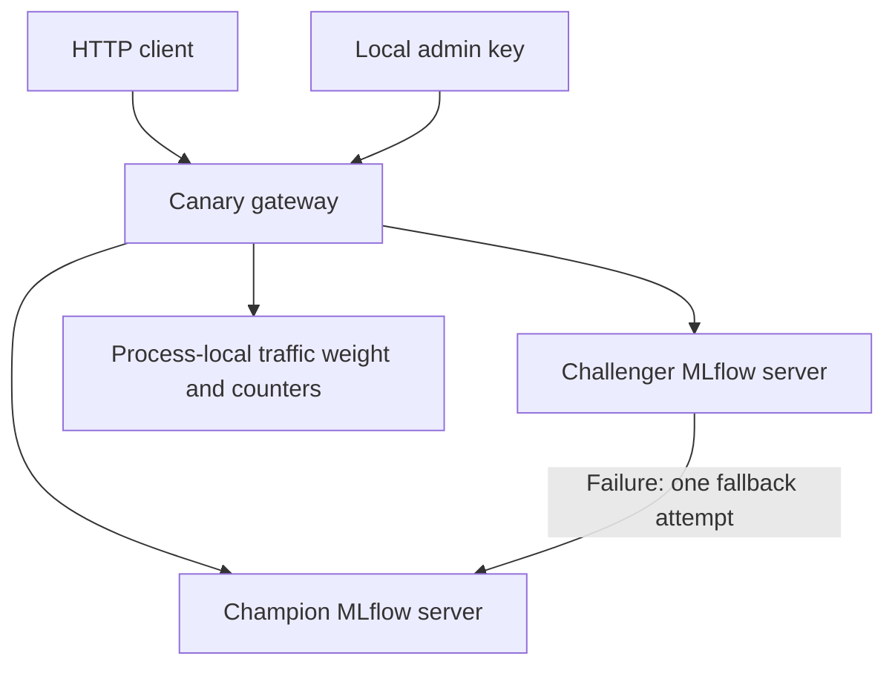
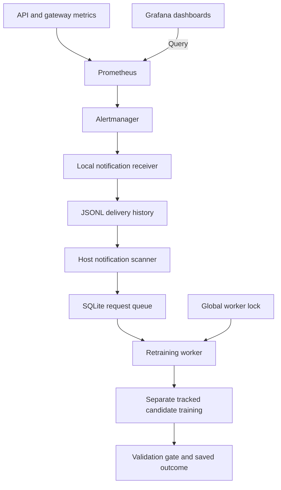

# FraudShield architecture

## What the system is

FraudShield is a small fraud-screening demo that runs on one machine, on CPU, using the
synthetic PaySim data. You give it a transaction and it returns a fraud score, a yes/no
decision and a SHAP explanation of the score. Around that there is a reproducible
training pipeline, monitoring, and a few controlled operations such as a canary gateway
and candidate retraining. It never approves or blocks a real payment.

There are two separate ways to serve the model. The web page talks straight to the API.
The canary gateway is an optional second path for trying a challenger model. Retraining
only ever produces a separate candidate; it never replaces a deployed model by itself.

## Data and training

The model only looks at three input fields: `type`, `amount` and `oldbalanceOrg`. From
those, a shared feature function builds nine features. There is a Python version and a
Spark version of that function, and tests check that both give the same answer. The data
is split by time into training, validation and held-out test parts.

DVC runs the preparation, both baseline trainings and the XGBoost validation gate. Tuning,
held-out evaluation and model registration are separate scripts that I run by hand. The
local CI script records what the tests and `dvc repro` did. Keep in mind that when DVC
finds nothing changed it skips the stage, so a passing `dvc repro` is not a fresh training
run. The `MLproject` file gives MLflow entry points for CI, the pipeline and the gate.

In MLflow I kept three kinds of run apart: historical imports of models trained earlier,
packaging runs, and real tracked training runs. A tracked training run records the code
commit, checksums of the source and data, package versions, validation metrics and the
model files.

## The main application

The browser loads the static frontend from port 8080, and the page calls the FastAPI
service on port 8000. Before the API reports itself ready, it checks the model file's
checksum and threshold against the registry receipt in `reports/mlflow_registry.json`.
After that it serves `/predict`, `/explain`, `/health` and `/metrics`.

The transaction page only accepts an API address on `localhost` or `127.0.0.1`. It
remembers that address in the browser's localStorage, and nothing else: transaction
values are never stored. When you switch to a different API it clears the old results and
checks the new API's health. The gateway can't be used as a backend for this page because
its responses look different.

The pipeline page shows the recorded command runs and saved report snapshots. The DVC
diagram on it shows how the pipeline is set up, not proof that it just ran, and the MLflow
numbers come from a saved snapshot rather than a live query.

## Optional canary gateway

The gateway listens on port 8020. The two model servers only have internal Docker
addresses. Each request is routed by hashing its transaction ID into a bucket, and the
challenger weight decides how many buckets go to the challenger. The weight starts at
zero and can only be changed with the admin key.

If the challenger fails, the gateway sends that request to the champion once and sets the
challenger weight back to zero, so later requests skip the challenger. Requests already in
flight are not cancelled. This only removes traffic: it does not roll back a model file or
promote anything. The gateway checks that the scores and decisions it gets back are
consistent, but a matching threshold does not prove which model answered.

## Monitoring and retraining

The API keeps the inputs of its last 500 successful predictions and compares them with
the training data, bucket by bucket, using total variation distance. It starts publishing
drift scores after 100 predictions. Traffic through the gateway does not count towards
this window.

Prometheus evaluates the drift rule and Alertmanager sends firing and resolved
notifications to a small local receiver, which saves only the fields it needs. A scanner
on the host turns recent firing drift alerts into queued requests. It ignores duplicate
deliveries, allows one active request per API instance and waits an hour before queueing
another request for the same instance.

Running a queued request is manual by default: an operator starts the worker for one
request. The worker can also poll the queue on its own with `--watch`, but only if you
start it that way, and I have only tested that mode with fake training commands. Either
way the worker trains a candidate in its own MLflow run on the approved training and
validation data, never the test split, and then runs the validation gate. Passing the gate
changes nothing in deployment. Promotion is always a separate manual step. I haven't shown
that retraining on the same data actually fixes a shifted input distribution.

## Deployment and where state lives

| Stack | Addresses on the host | What it keeps |
|---|---|---|
| Main Compose stack | Frontend 8080, API 8000, Prometheus 9095, Grafana 3010 | Model and receipt mounted read-only; Prometheus and Grafana volumes |
| Canary Compose stack | Gateway 8020 (model servers internal) | Exported MLflow packages and the admin key (not in Git) |
| Alert Compose stack | None | Alertmanager volume and the notification JSONL |
| Training on the host | Command line only | MLflow database and artifacts, the SQLite queue and worker logs |

Every published port is bound to localhost. The optional stacks join the
`fraudshield_default` network, so the main stack has to be started first. Grafana queries
`prometheus:9090`, and Prometheus scrapes `api:8000` and the gateway on port 8010.

- The API's drift window and the gateway's weight and counters reset when the process restarts.
- Notification deliveries: `runtime/alerts/notifications.jsonl`
- Retraining queue: `runtime/retraining/queue.db`
- Worker results: `runtime/retraining/runs/REQUEST_ID/`
- MLflow tracking and artifacts: `runtime/mlflow/`
- Exported serving packages: `runtime/mlflow-serving/`
- The local DVC cache and these runtime folders are not a backup; nothing is copied off the machine.

## Which model is which

| File | What it is |
|---|---|
| `artifacts/xgboost_v1/model.joblib` | The registered model the API serves, also exported as the gateway champion |
| `artifacts/xgboost_dvc_v1/model.joblib` | The frozen DVC baseline; the held-out test results belong to this one |
| `artifacts/xgboost_tuned_v1/model.joblib` | The tuned challenger candidate |
| `artifacts/xgboost_tracked/MLFLOW_RUN_ID/` | Candidates from tracked retraining |

These are different files and their results shouldn't be mixed up. In particular the
held-out numbers are for the DVC baseline, not for the served model. The
[test report](test_report.md) goes into this.

## What it doesn't do

There's no batch scoring, no way to feed back true labels, no automatic promotion and no
automatic rollback of the served model file. I haven't rebuilt the system on a fresh
machine or restored it from somewhere else. In the load tests the gateway sometimes
returned 503 errors and timings varied; later runs that passed don't mean the problem is
fixed. See the [load-test report](load_test_report.md).
