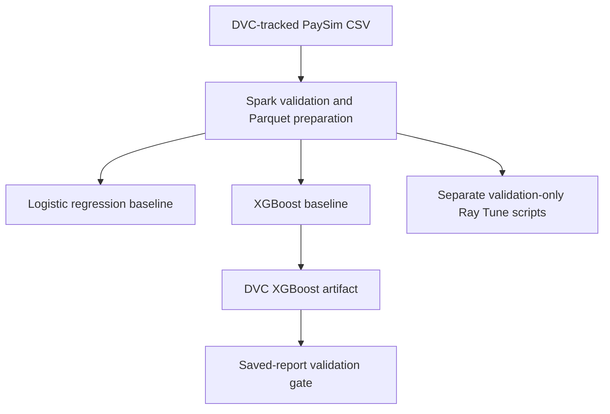
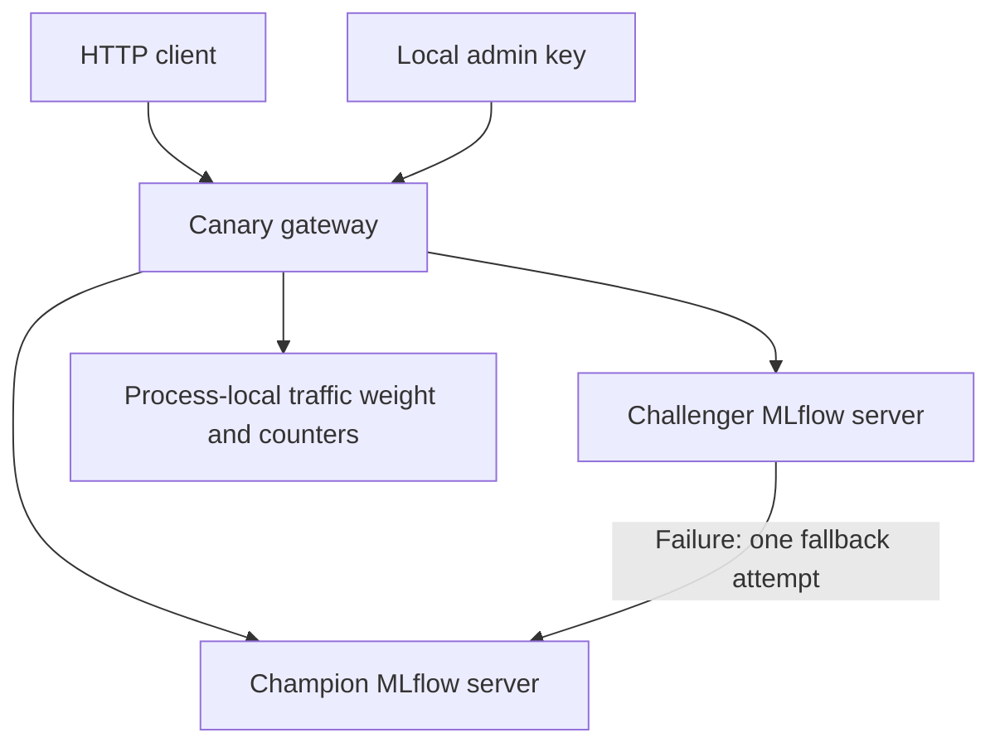

# FraudShield Architecture

## Purpose and verified scope

FraudShield is a local, CPU-based demonstration of fraud screening on synthetic
PaySim transactions. It provides model assessments, SHAP explanations,
reproducible baseline pipelines, monitored serving and controlled operations.
It does not authorize real payments.

The main application and optional canary gateway are separate serving paths.
The transaction frontend uses the direct API. Retraining produces a separate
candidate and does not change either deployed model automatically.

## Data and baseline training

Only `type`, `amount` and `oldbalanceOrg` enter the model. Shared Python and Spark
feature implementations produce nine features with parity checks. Chronological
splits separate training, validation and held-out evaluation.

DVC orchestrates preparation, baseline training and the XGBoost validation gate.
Tuning, held-out evaluation and registration use separate scripts. The local CI
runner records test and DVC command outcomes; a cache hit is not a fresh training
execution. MLproject supplies local CI, pipeline and gate entry points.

MLflow distinguishes historical imports, packaging runs and actual tracked
training. Tracked training records code identity, source/data checksums, package
versions, validation metrics and model artifacts.

## Main application and read-only console

The browser loads the static frontend on port 8080 and calls the direct FastAPI
service on port 8000. The API verifies the original model bundle's checksum and
threshold against its registry receipt before becoming ready. It loads the
pipeline directly and serves prediction, explanation, readiness and metrics.

The transaction page accepts an HTTP(S) API origin whose hostname is `localhost`
or `127.0.0.1`. It persists only that origin in browser localStorage, clears old
assessments when the active origin changes and checks the selected API's health.
It does not persist transaction inputs. The gateway is not a drop-in backend for
this UI because its response and explanation contracts differ.

The pipeline page displays sanitized command execution records and historical
report snapshots. Its diagram describes configured DVC topology, not evidence
that a new run occurred. Its MLflow evidence is a saved snapshot, not live queries.

## Optional canary serving path

The gateway publishes port 8020. The two model servers have internal Docker
addresses and no published host ports in this stack. Deterministic transaction-ID
buckets select routes. Authorized changes set challenger weight. An eligible
challenger failure removes subsequent challenger traffic and attempts one champion
fallback. In-flight requests are not cancelled.

This is automatic traffic removal, not artifact rollback or candidate promotion.
Response validation checks numerical and decision consistency. A matching threshold
does not establish upstream artifact identity. Startup challenger weight is zero.

## Monitoring, delivery and controlled candidate training

```mermaid
flowchart TD
    A["API and gateway metrics"] --> P["Prometheus"]
    G["Grafana dashboards"] -->|"Query"| P
    P --> M["Alertmanager"]
    M --> R["Local notification receiver"]
    R --> H["JSONL delivery history"]
    H --> S["Host notification scanner"]
    S --> Q["SQLite request queue"]
    Q --> W["Operator-started worker"]
    L["Global worker lock"] --> W
    W --> T["Separate tracked candidate training"]
    T --> V["Validation gate and saved outcome"]
```

The direct API's input drift monitor compares the last 500 successful prediction
inputs with training bucket proportions, using total variation. It publishes
scores after 100 observations. Gateway traffic does not update that window.

Prometheus evaluates the drift rule; Alertmanager delivers firing and resolved
notifications. The receiver persists approved fields. A host scanner queues
recent firing drift notifications, deduplicates deliveries, permits one active
request per API instance and applies a one-hour creation-time cooldown.

An operator explicitly starts one queued request. The worker trains on approved
train/validation data in a separate MLflow run and checks the saved validation
report and candidate identity. It does not use the test split for decisions.
Gate success leaves deployment unchanged. Continuous scanner/worker services and
automatic promotion have not been installed and verified. The demonstration does
not establish that retraining on existing data remedies a shifted distribution.

## Deployment and persistence

| Component group | Host endpoints | Persistent state |
|---|---|---|
| Main Compose stack | Frontend 8080, API 8000, Prometheus 9095, Grafana 3010 | Read-only model/receipt mounts; Prometheus and Grafana volumes |
| Canary Compose stack | Gateway 8020; model servers internal | Exported MLflow packages and ignored admin key |
| Alert Compose stack | Internal services; no host ports | Alertmanager volume and notification JSONL |
| Host-side training | Explicit CLI commands | MLflow database/artifacts, SQLite queue and worker logs |

Published ports bind to localhost. Optional stacks join `fraudshield_default`,
so the main stack creates that network first. Grafana queries `prometheus:9090`.
Prometheus scrapes `api:8000` and the gateway's monitoring-network alias on 8010.

- API drift state and gateway weight/counters reset with their processes.
- Notification deliveries live in `runtime/alerts/notifications.jsonl`.
- Queue state lives in `runtime/retraining/queue.db`.
- Worker evidence lives in `runtime/retraining/runs/REQUEST_ID/`.
- MLflow tracking and artifacts live under `runtime/mlflow/`.
- Exported serving packages live under `runtime/mlflow-serving/`.
- Local DVC cache and runtime state are not an off-machine backup.

## Model identity boundaries

| Artifact | Role |
|---|---|
| `artifacts/xgboost_v1/model.joblib` | Original registered model served by the direct API and exported champion |
| `artifacts/xgboost_dvc_v1/model.joblib` | Frozen baseline to which held-out results apply |
| `artifacts/xgboost_tuned_v1/model.joblib` | Tuned challenger candidate |
| `artifacts/xgboost_tracked/MLFLOW_RUN_ID/` | Separate tracked training candidates |

These are distinct artifacts. Held-out baseline results must not be attributed
to another artifact. See [the test report](test_report.md) for evidence boundaries.

## Remaining limits

Batch scoring, feedback labels, automatic promotion and artifact deployment
rollback are outside the verified implementation. Fresh-machine restoration and
off-machine recovery have not been demonstrated. Concurrent tests observed gateway
503 failures and variability; later successes do not establish a fix or SLA.
See [the load-test report](load_test_report.md).
