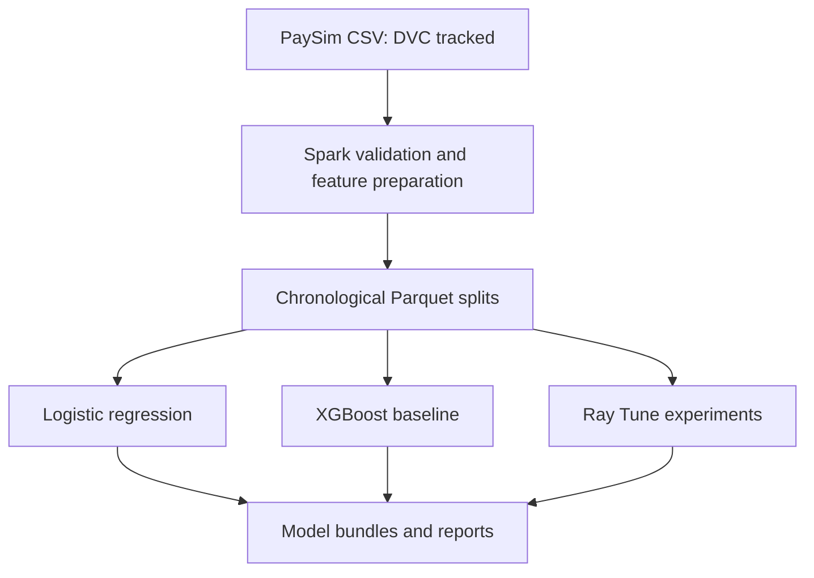
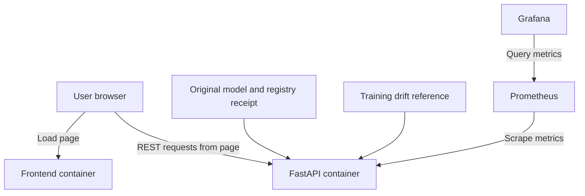

# FraudShield Architecture

## Purpose

FraudShield demonstrates local fraud scoring of synthetic PaySim transactions,
with explanations, reproducible training, service monitoring and input drift
detection. It does not authorize real payments.

## Offline training

DVC orchestrates Spark preparation and the two baseline training stages.
Ray tuning and candidate refitting currently run through separate scripts.
Validation data supports model and threshold selection.
The frozen DVC XGBoost baseline was subsequently evaluated on held-out test data.

## Online application

The browser executes the frontend JavaScript and calls FastAPI directly.
Frontend and inference are separate services connected through REST.
The API base URL is currently hardcoded in the frontend.

## Components

| Component | Responsibility |
|---|---|
| Validation scripts | Check dataset checksum, schema, values and statistics |
| Spark preparation | Construct features and verify chronological Parquet outputs |
| DVC | Version raw data and baseline preparation/training outputs |
| Training scripts | Fit models and select thresholds on validation data |
| Ray Tune | Compare four XGBoost configurations on validation data |
| MLflow | Track historical original-model results and register packaged models |
| FastAPI | Validate requests, score inputs, explain results and expose metrics |
| Frontend | Collect transaction inputs and display assessments |
| Drift monitor | Compare recent prediction-input buckets with training references |
| Prometheus | Scrape metrics and evaluate input drift alerts |
| Grafana | Display service and drift metrics |

## Local ports and connections

| Service | Host address |
|---|---|
| Frontend | http://127.0.0.1:8080 |
| FastAPI | http://127.0.0.1:8000 |
| Prometheus | http://127.0.0.1:9095 |
| Grafana | http://127.0.0.1:3010 |

Inside Compose, Prometheus scrapes api:8000 and Grafana queries prometheus:9090.
Published service ports bind to localhost.

## Request flow

1. The browser collects type, amount and sender balance.
2. FastAPI validates the three-field request.
3. Shared feature logic transforms the input for the loaded model.
4. The API returns a score, threshold, decision and model identity.
5. The explanation endpoint also returns raw-log-odds feature contributions.
6. Middleware records aggregate request metrics.
7. Successful prediction requests update the process-local drift window.

## State and persistence

- Model bundles and the registry receipt are read-only API bind mounts.
- Prometheus time-series data uses the prometheus_data named volume.
- Grafana settings and account state use the grafana_data named volume.
- MLflow tracking and artifacts are stored under runtime/mlflow.
- DVC maintains a local cache; off-machine recovery is not established.
- The API drift window is process-local and resets on restart.

## Model identity boundaries

The deployed API loads artifacts/xgboost_v1/model.joblib and verifies its
checksum and threshold against reports/mlflow_registry.json.

The held-out evaluation concerns artifacts/xgboost_dvc_v1/model.joblib.
The tuned candidate is artifacts/xgboost_tuned_v1/model.joblib.
These are distinct artifacts; their results must not be conflated.

## Planned extensions

Pipeline run recording, quality gates, a pipeline console, MLflow serving,
automated canary routing, alert delivery and controlled retraining are planned.
They are not represented as implemented components in these diagrams.

The completed local canary drill used separate candidate serving and test-client
routing. It did not perform automated promotion or deployment rollback.
