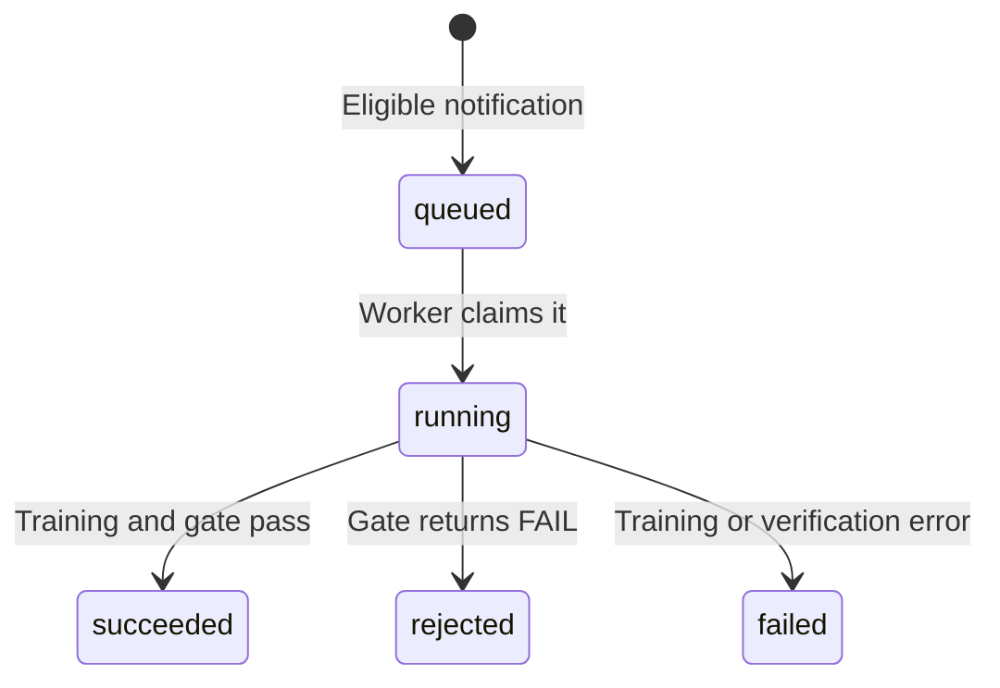

# FraudShield low-level design

## The direct API

The API lives at `http://127.0.0.1:8000`. To score a transaction you send JSON with exactly
these three fields:

| Field | Allowed values |
|---|---|
| `type` | CASH_IN, CASH_OUT, DEBIT, PAYMENT or TRANSFER |
| `amount` | A finite number, zero or more |
| `oldbalanceOrg` | A finite number, zero or more |

Any other field is rejected. Amount and balance are in the same currency unit. For example:
`{"type":"TRANSFER","amount":100000,"oldbalanceOrg":100000}`.

| Method | Path | What it does |
|---|---|---|
| POST | `/predict` | Scores one transaction; 422 for bad input |
| POST | `/explain` | Scores and explains it; 422 for bad input |
| GET | `/health` | Readiness and model identity; 503 while not ready |
| GET | `/metrics` | Prometheus metrics |
| GET | `/pipeline/runs` | Recent recorded runs, size-limited and cleaned up; 503 if the file can't be read |
| GET | `/pipeline/summary` | The saved pipeline snapshot; 503 if it's missing or invalid |
| GET | `/docs`, `/redoc`, `/openapi.json` | The API description |

There's no page at the root. An unexpected error during scoring can come back as a 500, and
if startup fails the API won't accept connections at all. There are no endpoints for batch
scoring, feedback or starting the pipeline.

## What comes back

A prediction contains `score`, `threshold`, a boolean `predicted_fraud`, `model_name` and
`model_version`. Score and threshold are finite numbers between 0 and 1, and the decision is
simply `score >= threshold`. I don't claim the score is a calibrated probability.

An explanation adds `base_value`, `raw_margin`, `contribution_units` and `contributions`. The
units are raw model log-odds. Each contribution has a `feature` and a `shap_log_odds` value,
sorted with the largest absolute effect first, and the base value plus all contributions comes
out (approximately) at the raw margin. The contributions explain how the model behaved, not
what caused anything and not whether fraud really happened.

When ready, `/health` returns `status="ready"`, the model name and version and `model_sha256`.
When it isn't ready it returns 503 with `{"status":"not_ready"}`. Bad scoring input returns 422
with `{"detail":"Invalid transaction input."}`. Don't rely on any particular JSON shape for an
unexpected 500.

## Example requests and responses

The direct-API examples below are real outputs from the served model, from a local run on
2026-11-10. IDs and timestamps change every run and the scores depend on the input. The
gateway and receiver examples follow the code in `backend/gateway.py` and
`backend/alert_receiver.py` and were checked with FastAPI's in-process test client. The error
bodies are the ones described above. `docs/openapi.json` is the machine-readable description of
the direct API, generated with `app.openapi()` on 2026-11-10. Note that it shows FastAPI's
default 422 schema, while the direct API actually returns the short generic body shown below.

### Direct API (`http://127.0.0.1:8000`)

**POST /predict**, request and a flagged result:

```json
{
  "type": "TRANSFER",
  "amount": 100000,
  "oldbalanceOrg": 100000
}
```

```json
{
  "score": 0.9916079044342041,
  "threshold": 0.9195699691772461,
  "predicted_fraud": true,
  "model_name": "FraudShield-XGBoost",
  "model_version": "1"
}
```

A low-risk example (`{"type":"PAYMENT","amount":50,"oldbalanceOrg":1000}`) returned
`score` 5.64e-06 with `predicted_fraud: false` and the same `threshold`.

**POST /explain**, same request; the response adds `base_value`, `raw_margin`,
`contribution_units` and nine contributions sorted by absolute size:

```json
{
  "score": 0.9916079044342041,
  "threshold": 0.9195699691772461,
  "predicted_fraud": true,
  "model_name": "FraudShield-XGBoost",
  "model_version": "1",
  "base_value": -5.609713077545166,
  "raw_margin": 4.772031784057617,
  "contribution_units": "raw model log-odds",
  "contributions": [
    {
      "feature": "amount_exceeds_balance",
      "shap_log_odds": 4.380070209503174
    },
    {
      "feature": "amount_balance_fraction",
      "shap_log_odds": 4.200893402099609
    },
    {
      "feature": "type_TRANSFER",
      "shap_log_odds": 2.510343313217163
    },
    {
      "feature": "type_CASH_OUT",
      "shap_log_odds": -0.4414238929748535
    },
    {
      "feature": "log_amount",
      "shap_log_odds": -0.3235665261745453
    },
    {
      "feature": "log_sender_balance",
      "shap_log_odds": -0.1936536431312561
    },
    {
      "feature": "type_PAYMENT",
      "shap_log_odds": 0.1470889002084732
    },
    {
      "feature": "type_CASH_IN",
      "shap_log_odds": 0.10191535949707031
    },
    {
      "feature": "type_DEBIT",
      "shap_log_odds": 8.002507092896849e-05
    }
  ]
}
```

**Invalid input** (unknown type, negative amount, extra or missing fields), status 422 for
both POST endpoints. The body never repeats the submitted values:

```json
{
  "detail": "Invalid transaction input."
}
```

**GET /health**, status 200 when ready:

```json
{
  "status": "ready",
  "model_name": "FraudShield-XGBoost",
  "model_version": "1",
  "model_sha256": "1d2df49373788c5b1e554ec9ab9cfc346cc0feb1e13406bc0cd93b1594518bcb"
}
```

When the model is not loaded the status is 503 with `{"status": "not_ready"}`.

**GET /metrics** returns Prometheus text. A few real lines (counters also have `_created`
lines and histograms `_bucket` lines):

```text
fraudshield_requests_total{endpoint="/predict",status="200"} 2.0
fraudshield_requests_total{endpoint="/explain",status="200"} 1.0
fraudshield_requests_total{endpoint="/predict",status="422"} 1.0
fraudshield_request_duration_seconds_count{endpoint="/predict"} 3.0
fraudshield_request_duration_seconds_sum{endpoint="/predict"} 0.04790308100018592
fraudshield_request_duration_seconds_count{endpoint="/explain"} 1.0
fraudshield_request_duration_seconds_sum{endpoint="/explain"} 0.01887118400009058
```

**GET /pipeline/runs?limit=N** (`N` from 1 to 100, default 50) returns recorded command
executions, newest first, reading at most the last 1 MiB of the history file:

```json
{
  "history_available": true,
  "truncated": false,
  "invalid_records": 0,
  "runs": [
    {
      "run_id": "c66d63a9-1195-4c3f-b1b7-1c32f4864fb3",
      "stage": "dvc_reproduction",
      "status": "success",
      "started_utc": "2026-11-10T13:41:38.682134+00:00",
      "finished_utc": "2026-11-10T13:43:39.320915+00:00",
      "duration_seconds": 120.63845133900031,
      "git_commit": "90363c4ef0f18a5138225d2d032b889bc429cf8b",
      "git_dirty": true,
      "failure_reasons": []
    }
  ]
}
```

Status 503 with `{"detail": "Pipeline history is temporarily unavailable."}` if the file
cannot be read.

**GET /pipeline/summary** returns the saved snapshot `reports/pipeline_summary.json`. Its keys
are `schema_version, generated_utc, scope, spark, registered_original_models, ray_tuning, source_report_sha256`; `spark` looks like:

```json
{
  "scope": "original complete preparation job, not DVC rerun",
  "rows": 6362620,
  "total_seconds": 82.82915609499969,
  "effective_rows_per_second": 76816.18768036808,
  "timing_scope": "whole-job elapsed time including validation and readback; not individual-stage throughput",
  "output": "data/processed/paysim_spark_v1",
  "spark_version": "3.5.7"
}
```

Status 503 with `{"detail": "Historical pipeline summary is unavailable."}` if the file is
missing or not a version 1 summary.

**GET /docs**, **/redoc** and **/openapi.json** serve the interactive and raw API description.

### Canary gateway (`http://127.0.0.1:8020`)

**GET /health**, status 200:

```json
{
  "status": "configured",
  "scope": "gateway initialized; does not verify upstream health"
}
```

**GET /routing**, status 200:

```json
{
  "canary_weight": 0,
  "challenger_configured": true,
  "fallback_attempts": 0,
  "rollback_on_failure": true,
  "automatic_rollbacks": 0
}
```

**POST /predict** with the same three-field body as the direct API and an optional
`X-Transaction-ID` header (1 to 128 characters). Illustrative response (the champion's
SHA-256 appears because the gateway checks the expected model identity):

```json
{
  "score": 0.9916,
  "threshold": 0.9195699691772461,
  "predicted_fraud": true,
  "model_sha256": "1d2df49373788c5b1e554ec9ab9cfc346cc0feb1e13406bc0cd93b1594518bcb",
  "transaction_id": "gateway-example",
  "requested_route": "champion",
  "route": "champion",
  "fallback": false,
  "rollback_triggered": false
}
```

Errors: status 503 `{"detail": "Scoring service is temporarily unavailable."}`; status 422 for
an invalid body or blank transaction ID. Unlike the direct API, an invalid body returns FastAPI's
default 422 body, which lists each problem and repeats the submitted value in `input`:

```json
{
  "detail": [
    {
      "type": "literal_error",
      "loc": [
        "body",
        "type"
      ],
      "msg": "Input should be 'CASH_IN', 'CASH_OUT', 'DEBIT', 'PAYMENT' or 'TRANSFER'",
      "input": "BAD",
      "ctx": {
        "expected": "'CASH_IN', 'CASH_OUT', 'DEBIT', 'PAYMENT' or 'TRANSFER'"
      }
    }
  ]
}
```

**POST /admin/canary** with header `X-API-Key` and body `{"weight": 10}` (integer 0 to 100):

```json
{
  "canary_weight": 10,
  "challenger_configured": true,
  "fallback_attempts": 0,
  "rollback_on_failure": true,
  "automatic_rollbacks": 0
}
```

Errors: 401 `{"detail": "Invalid admin credentials."}`; 409
`{"detail": "Requested canary configuration is unavailable."}` (for example a positive weight
without a challenger); 422 (default body) for a weight outside 0 to 100.

**GET /metrics** returns the gateway registry (names are listed under "Upstream client and
gateway metric semantics").

### Alert receiver (internal, port 8030, no host port)

**GET /health**: `{"status": "configured"}`.

**POST /alerts**, request (Alertmanager style; at most 20 alerts and 64 KB):

```json
{
  "status": "firing",
  "alerts": [
    {
      "status": "firing",
      "labels": {
        "alertname": "FraudShieldInputDrift",
        "severity": "warning",
        "job": "fraudshield-api",
        "instance": "api:8000",
        "feature": "amount"
      }
    }
  ]
}
```

Response, status 200 (`delivery_id` is a new UUID each time):

```json
{
  "status": "recorded",
  "delivery_id": "00000000-0000-4000-8000-000000000000"
}
```

Errors: 413 `{"detail": "Notification too large."}`; 422 `{"detail": "Invalid notification."}`;
503 `{"detail": "Notification storage unavailable."}`.

## How the API starts

1. Read the XGBoost entry of the registry receipt and hash the original model bundle.
2. Stop if the checksum doesn't match, before loading anything.
3. Check the threshold is valid and equal to the receipt's threshold.
4. Set up the pipeline, the explainer, the model identity and the drift monitor.
5. Report ready. On shutdown, drop the model references and stop reporting ready.

The API loads its model file directly. The optional gateway goes through separate MLflow HTTP
servers instead; don't mix the two up.

## Features

Inputs: `type`, `amount`, `oldbalanceOrg`.

The nine features, in order: `log_amount`, `log_sender_balance`, `amount_balance_fraction`,
`amount_exceeds_balance`, `type_CASH_IN`, `type_CASH_OUT`, `type_DEBIT`, `type_PAYMENT`,
`type_TRANSFER`.

The Python feature builder rejects anything that breaks the schema or the value rules. The
Spark parity tests cover every supported transaction type and the edge values.

## The web page's connection and request handling

The page starts with `http://127.0.0.1:8000`. `normalizeAPI` accepts an HTTP or HTTPS address
whose host is `localhost` or `127.0.0.1`, with an optional port and nothing after the `/`. It
refuses user names and passwords, paths, query strings and fragments. The cleaned-up address is
saved under `fraudshield.apiOrigin` if localStorage works; if it doesn't, the address is only
used for the open page, and a broken saved value falls back to the default.

Applying a valid address clears the old result and checks the new API's health. A rejected
address leaves the current connection alone. Each health check has a generation number so an
older, slower answer can't overwrite a newer one. While a request is running the form and
connection controls are disabled, and editing any field clears the previous result. Only the
address is saved, never the transaction values. The browser gives up after 20 seconds.

The page is built for the direct API. Gateway responses don't have the same model identity
and explanation fields, so the page can't use the gateway.

The direct API's CORS policy allows `http://127.0.0.1:8080` and `http://localhost:8080`, GET and
POST, the Content-Type header and no credentials. Pointing the page at another API doesn't
change that server's CORS policy.

## API metrics and drift

The request and latency metrics keep `/predict` and `/explain` apart. Request counts include
bad input and server errors. Decision counts are what the model said, not confirmed fraud. Only
successful, completed `/predict` calls update the drift window; explanations and bad input don't.

The window holds 500 predictions, publishes scores once it has 100, and only keeps bucket
numbers. Each drift score is total variation distance: half the sum of the absolute differences
between the recent and the training bucket proportions. Numbers are bucketed by where they fall
between the cut points (inserting on the right); the type uses its fixed categories. Restarting
the process empties the window.

`FraudShieldInputDrift` fires when a score stays above 0.20 for 30 seconds, as long as there has
been recent prediction traffic and Prometheus can scrape the API. The exact PromQL is in
`monitoring/drift_rules.yml`. The 0.20 is a demo setting, not a calibrated accuracy monitor.
Predictions through the gateway don't count.

## The gateway

The gateway lives at `http://127.0.0.1:8020` and runs one worker, which owns the routing state.

| Method | Path | What it does |
|---|---|---|
| GET | `/health` | Says it's configured; doesn't call the model servers |
| GET | `/routing` | Weight, whether a challenger is configured, and the fallback and removal counters |
| GET | `/metrics` | The gateway's Prometheus metrics |
| POST | `/predict` | The three transaction fields, plus an optional X-Transaction-ID header |
| POST | `/admin/canary` | A whole-number `weight` from 0 to 100; needs X-API-Key |

A gateway prediction adds `transaction_id`, `requested_route`, `route`, `fallback` and
`rollback_triggered` to the score, threshold and decision. If you don't send a transaction ID
one is generated; if you do, it has to be non-blank and at most 128 characters. The ID only
picks the route and is never sent to a model server. A gateway response doesn't prove which
model file answered.

Bad transactions or IDs get 422. A model-client failure becomes a generic 503. A wrong admin key
gets 401, and a configuration that isn't possible (like a positive weight with no challenger)
gets 409. The admin key has to be at least 32 characters and is never logged.

The route is chosen by hashing the transaction ID with SHA-256 into a bucket. A lock protects
the configuration, but the HTTP calls happen outside it. When the challenger fails in a way that
counts, its traffic is removed first and then the champion is tried once. If the champion fails
as well, the error is passed back without retrying. A generation number stops an old failure
from switching off a newer configuration, and requests already in flight are allowed to finish.

## The model client and the gateway metrics

The client that calls the model servers ignores proxy environment variables, since the servers
are local. It limits the response size and checks that there's exactly one row, that score and
threshold are finite, that the threshold is exactly the expected one and that the decision
matches. Its timeout is separate from the browser's. Its warnings only include the host, the
kind of error, the exception class and the elapsed time, never transaction values or the
exception text.

| Metric | Meaning |
|---|---|
| `fraudshield_gateway_requests_total` | POST prediction requests by HTTP status |
| `fraudshield_gateway_request_duration_seconds` | Time per request, including the upstream call and any fallback |
| `fraudshield_gateway_scoring_results_total` | Successful results by requested route, actual route and fallback |
| `fraudshield_gateway_canary_weight_percent` | The configured challenger percentage |
| `fraudshield_gateway_fallback_attempts_total` | Fallback attempts, even ones where the champion also failed |
| `fraudshield_gateway_automatic_removals_total` | Times challenger traffic was removed automatically |

A scoring result being counted doesn't mean the client received it, and it isn't a fraud count.
The routing state and counters reset when the gateway restarts. Scraping `/metrics` doesn't count
as a prediction, and each app instance has its own metrics registry.

## The alert receiver and the request scanner

The internal receiver accepts POST `/alerts` with a body of at most 65,536 bytes and 1 to 20
alerts. The notification and each alert must be either firing or resolved. It keeps only the
labels it needs, gives the delivery a UUID, appends it to the JSONL file and flushes and fsyncs
before answering. Malformed input gets 422, too-large input 413 and a storage failure a generic
503. Its `/health` only says it's configured, not that it can write. Alertmanager may retry, so
one alert can produce several delivery records.

Alertmanager is set up to send local notifications, including resolved ones. None of these
services publish a port on the host. The real configuration is in `monitoring/alertmanager.yml`.

The scanner on the host reads the last 1 MiB of the delivery history, skips incomplete or
invalid records and timestamps without a time zone, and accepts records up to 15 minutes old
(and up to 60 seconds in the future, for clock skew). It only takes firing
`FraudShieldInputDrift` alerts from job `fraudshield-api` with a supported feature and a valid
instance. Synthetic test deliveries and resolved notifications are ignored.

## The queue and the worker

SQLite transactions make sure each delivery ID is only processed once. A partial unique index
allows one queued or running request per API instance, and there's a one-hour cooldown based on
when a request was created, which applies even after it finishes. Features from the same
instance in one notification are grouped into one request. New deliveries that arrive while a
request is active are dropped instead of starting a second job.



The worker runs one request at a time under a global process lock. Normally you give it a
request ID; with `--watch` it picks up queued requests itself, oldest first, through the same
code. Before running it checks that the worker, gate and trainer sources are tracked by Git and
unchanged. It trains into a new MLflow artifact folder with its own receipt, checks the receipt
belongs to this request and keeps candidate files inside their folder. Training has a 900-second
timeout and the gate 60 seconds. Logs and the result go to `runtime/retraining/runs/REQUEST_ID/`.

The result is written to disk before the queue status changes. If storage fails or the process
is interrupted in between, the request can be left `running` for someone to look at; nothing
replays or resumes it automatically ([retraining_recovery.md](retraining_recovery.md)). A request
that isn't queued is refused. `succeeded` only means the candidate trained and passed the gate. It
doesn't mean it was registered, promoted or deployed.

The gate floors are AP 0.85, precision 0.70 and recall 0.90. The gate checks that the saved report
is validation-only, the values are finite, the report is well-formed and the model checksum
matches. It doesn't re-evaluate the data itself, compare the candidate with the champion or show
that drift was fixed.

## DVC stages and evidence

| Stage | Main output |
|---|---|
| spark_prepare | `data/processed/paysim_spark_dvc_v1` |
| logreg_train | `artifacts/logreg_dvc_v1` |
| xgboost_train | `artifacts/xgboost_dvc_v1` |
| xgboost_validation_gate | `reports/xgboost_validation_gate.json` |
| unit_tests | `reports/unit_tests_result.json` |

The exact dependencies are in `dvc.yaml` and the recorded hashes in `dvc.lock`. Local CI appends a
record of every command it actually ran and saves the logs. The pipeline history endpoint only
exposes a limited, cleaned-up set of fields, never the raw commands or logs. The summary endpoint
serves a saved snapshot. Held-out evaluation, tuning and registration are still separate scripts.

## Where things are in the code

| What | Source |
|---|---|
| Direct API routes, schema and startup | backend/app.py |
| API metrics and drift | backend/metrics.py, backend/drift.py |
| Pipeline history and snapshot | backend/pipeline.py |
| Model client | backend/model_client.py |
| Routing and gateway | backend/canary.py, backend/gateway.py, backend/gateway_server.py |
| Gateway metrics | backend/gateway_metrics.py |
| Alert receiver | backend/alert_receiver.py |
| Queue and scanner | backend/retraining_queue.py, scripts/enqueue_drift_requests.py |
| Worker | backend/retraining_worker.py, scripts/run_retraining_worker.py |
| Features and explanations | src/fraudshield/features.py, src/fraudshield/explanations.py |
| MLflow wrapper | src/fraudshield/mlflow_model.py |
| Frontend and pipeline page | frontend/index.html, frontend/pipeline.html, frontend/pipeline_summary.js |
| Deployment | compose.yaml, compose.canary.yaml, compose.alerts.yaml |

The direct API's model paths and CORS settings are in the code. The gateway reads CHAMPION_URL,
CHALLENGER_URL, CHALLENGER_THRESHOLD, MODEL_TIMEOUT_SECONDS, GATEWAY_REGISTRY_FILE and
GATEWAY_ADMIN_KEY_FILE from the environment, and ALERT_HISTORY_FILE sets where the receiver
stores deliveries. The compose files set resources, mounts and ports. The local UID/GID variables
let the canary and receiver containers use their bind mounts without running as root. Grafana's
initial password comes from the local `.env`, which isn't in Git.
