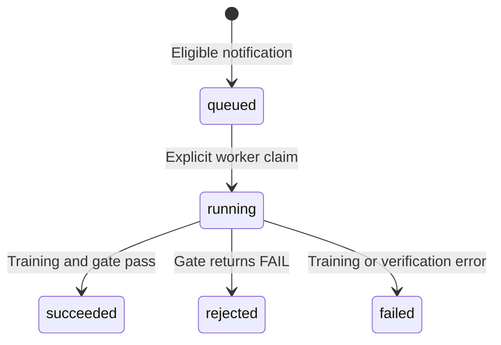

# FraudShield Low-Level Design

## Direct API request contract

Base URL: `http://127.0.0.1:8000`. Scoring uses JSON with exactly these fields:

| Field | Constraint |
|---|---|
| `type` | CASH_IN, CASH_OUT, DEBIT, PAYMENT or TRANSFER |
| `amount` | Finite, nonnegative number |
| `oldbalanceOrg` | Finite, nonnegative number |

Additional fields are forbidden. Amount and balance use the same monetary unit.
Example: `{"type":"TRANSFER","amount":100000,"oldbalanceOrg":100000}`.

| Method | Path | Purpose and errors |
|---|---|---|
| POST | `/predict` | Score one transaction; invalid input 422 |
| POST | `/explain` | Score and explain; invalid input 422 |
| GET | `/health` | Ready/model identity; not-ready 503 |
| GET | `/metrics` | API Prometheus exposition |
| GET | `/pipeline/runs` | Bounded, sanitized history; unavailable storage 503 |
| GET | `/pipeline/summary` | Historical snapshot; missing/invalid snapshot 503 |
| GET | `/docs`, `/redoc`, `/openapi.json` | API specification |

There is no API root homepage. Unexpected inference failures can return 500;
startup failure can prevent connection entirely. Batch scoring, feedback and UI
pipeline-launch endpoints are not implemented.

## Response and explanation contracts

Prediction returns `score`, `threshold`, boolean `predicted_fraud`, `model_name`
and `model_version`. Score and threshold are finite in [0,1]; decision is
`score >= threshold`. Score is not claimed to be a calibrated fraud probability.

Explanation adds `base_value`, `raw_margin`, `contribution_units` and
`contributions`. Units are raw model log-odds. Each contribution has `feature`
and `shap_log_odds`, sorted by descending absolute magnitude. Base value plus
contributions approximately reconstructs raw margin. Contributions explain model
behavior, not causality or confirmed fraud.

Ready health contains `status="ready"`, model name/version and `model_sha256`.
The documented direct-API not-ready body is `{"status":"not_ready"}` with 503.
Invalid scoring input returns 422 with `{"detail":"Invalid transaction input."}`.
Clients must not assume a structured JSON contract for unexpected 500 responses.

## Direct API startup

1. Read the XGBoost registry receipt and hash the original model bundle.
2. Reject a checksum mismatch before loading the trusted bundle.
3. Validate the threshold and its equality to the receipt threshold.
4. Initialize pipeline, explainer, model identity and drift monitor.
5. Set readiness; clear inference references and readiness at shutdown.

This API loads its bundle directly. The optional gateway uses separate MLflow
HTTP servers; the paths must not be conflated.

## Feature order

Inputs: `type`, `amount`, `oldbalanceOrg`.

Output order: `log_amount`, `log_sender_balance`, `amount_balance_fraction`,
`amount_exceeds_balance`, `type_CASH_IN`, `type_CASH_OUT`, `type_DEBIT`,
`type_PAYMENT`, `type_TRANSFER`.

The Python feature builder rejects schema and value violations. Spark parity
checks cover supported transaction types and edge values.

## Frontend connection and request state

The page defaults to `http://127.0.0.1:8000`. `normalizeAPI` accepts HTTP(S)
origins with hostname `localhost` or `127.0.0.1`, optional port and root path.
It rejects credentials, non-root paths, queries and fragments. The normalized
origin is persisted under `fraudshield.apiOrigin` when localStorage is available.
Storage failure permits page-local use; invalid saved settings fall back to default.

Applying a valid address clears the old assessment and checks health. Rejected
input leaves the active connection unchanged. Health-check generations prevent
older responses from overwriting newer state. Scoring disables transaction and
connection controls; changing transaction inputs clears the previous result.
Only the origin is persisted, not transaction values. The browser timeout is 20s.

The UI is for the direct prediction/explanation API. Gateway responses do not
contain the same model identity and explanation fields.

Direct API CORS permits `http://127.0.0.1:8080` and `http://localhost:8080`, GET/POST,
Content-Type, and no credentials. Changing the API destination does not add new
browser origins to the server's CORS policy.

## Direct API metrics and drift

Request and latency metrics distinguish `/predict` and `/explain`. Request counts
include invalid inputs and server failures. Successful decision counts are model
outputs, not ground-truth fraud counts. Drift updates only after successful,
completed direct `/predict` responses, excluding explanations and invalid inputs.

The 500-observation window publishes after 100 samples and retains bucket indices.
Each score is total variation: half the sum of absolute differences between recent
and training bucket proportions. Numeric bucketing uses right-side cut insertion;
type has fixed categories. Process restart clears the window.

`FraudShieldInputDrift` requires a score above 0.20, recent prediction activity,
API scrape health, and a 30-second sustained condition. See the actual PromQL in
`monitoring/drift_rules.yml`. This policy is a demonstration, not calibrated accuracy
monitoring. Gateway predictions do not enter this window.

## Gateway routes and state

Base URL: `http://127.0.0.1:8020`. One worker owns routing state.

| Method | Path | Contract |
|---|---|---|
| GET | `/health` | Configuration status; does not probe scoring upstreams |
| GET | `/routing` | Weight, challenger configuration and recovery counters |
| GET | `/metrics` | Gateway Prometheus registry |
| POST | `/predict` | Three transaction inputs; optional X-Transaction-ID |
| POST | `/admin/canary` | Strict integer `weight` 0–100; X-API-Key required |

Prediction adds `transaction_id`, `requested_route`, `route`, `fallback` and
`rollback_triggered` to score/threshold/decision. Missing IDs are generated;
supplied IDs must be nonblank and at most 128 characters. IDs select a route and
are not passed to model servers. Gateway responses do not prove artifact identity.

Invalid transactions/IDs return 422. Model-client failures return generic 503.
Invalid admin credentials return 401; unavailable canary configuration returns 409.
The configured admin key must contain at least 32 characters; values are not logged.

SHA-256 transaction-ID buckets determine traffic selection. A lock protects
configuration; HTTP calls run outside it. On eligible challenger failure, automatic
removal occurs before one champion fallback attempt. If champion also fails, the
error propagates without a retry loop. Configuration generations prevent stale
failures from disabling a newer routing configuration. In-flight calls can finish.

## Upstream client and gateway metric semantics

The synchronous client ignores proxy environment variables for local upstreams.
It bounds response bytes, checks one-row shape, finite score/threshold, exact
expected threshold and boolean decision consistency. Configured timeout is separate
from browser timeout. Sanitized warnings expose host, error category, exception
class and elapsed time, without transaction values or exception-message text.

| Metric | Meaning |
|---|---|
| `fraudshield_gateway_requests_total` | POST prediction requests by HTTP status |
| `fraudshield_gateway_request_duration_seconds` | Duration including upstream HTTP and fallback |
| `fraudshield_gateway_scoring_results_total` | Successful scoring results by requested/actual route and fallback |
| `fraudshield_gateway_canary_weight_percent` | Configured challenger percentage |
| `fraudshield_gateway_fallback_attempts_total` | Fallback attempts, even if champion also fails |
| `fraudshield_gateway_automatic_removals_total` | Automatic changes removing challenger traffic |

Scoring-result counts are not guaranteed client delivery or confirmed fraud counts.
Routing state and counters reset with the gateway process. Metrics scrapes are not
prediction requests; each app instance has an isolated metrics registry.

## Alert receiver and request scanner

The internal receiver accepts POST `/alerts`, at most 65536 body bytes and 1–20
alerts. Notification and alert status must be firing/resolved. It retains approved
labels, assigns a delivery UUID, appends JSONL, flushes and fsyncs before replying.
Malformed input returns 422, oversized input 413, storage failure generic 503.
Its `/health` reports configuration, not a storage-write guarantee. Retries can
produce multiple delivery records; the receiver is not an exactly-once transport.

Alertmanager routes local notifications with resolved delivery enabled. No host
ports are published for these services. Actual config is in `monitoring/alertmanager.yml`.

The host scanner reads the latest 1 MiB of history, skips incomplete/invalid records
and naive timestamps, and accepts a 15-minute age window with up to 60s future skew.
It accepts firing `FraudShieldInputDrift`, job `fraudshield-api`, supported features
and a valid instance. Synthetic delivery checks and resolved notifications are ignored.

## Queue and worker state machine

SQLite transactions deduplicate delivery IDs. A partial unique index enforces one
queued/running request per API instance. A one-hour cooldown uses request creation
time, including after terminal completion. Evidence groups supported features from
the same instance within a notification. New deliveries during an active request
are suppressed rather than launching parallel work.

The worker takes an explicit request ID and a global process lock. CLI preflight
requires tracked, unchanged worker/gate/trainer sources. It trains into a new MLflow
artifact directory with a separate receipt, checks request identity and confines
candidate paths. Training timeout is 900s; gate timeout is 60s. Logs and result
are saved under `runtime/retraining/runs/REQUEST_ID/`.

Terminal evidence is flushed before updating queue state. Storage failure or process
interruption can leave `running` for operator investigation; no automatic replay or
resume is implemented. A non-queued request is refused. `succeeded` means candidate
training and gate success, not registration, promotion or deployment.

Gate floors: AP 0.85, precision 0.70, recall 0.90. It checks saved validation scope,
finite values, serialization status and model checksum. It does not independently
re-evaluate the dataset, establish superiority over champion or establish drift repair.

## DVC and evidence contracts

| Stage | Main output |
|---|---|
| spark_prepare | `data/processed/paysim_spark_dvc_v1` |
| logreg_train | `artifacts/logreg_dvc_v1` |
| xgboost_train | `artifacts/xgboost_dvc_v1` |
| xgboost_validation_gate | `reports/xgboost_validation_gate.json` |

Exact dependency declarations are in `dvc.yaml`; recorded identities are in `dvc.lock`.
Local CI appends actual command records and saves logs. Pipeline history exposes
bounded sanitized fields, not raw commands/logs. The summary endpoint serves a saved
report snapshot. Held-out evaluation, tuning and registration remain separate scripts.

## Configuration and source mapping

| Responsibility | Source |
|---|---|
| Direct routes/schema/lifecycle | backend/app.py |
| API metrics and drift | backend/metrics.py, backend/drift.py |
| Pipeline history and snapshot | backend/pipeline.py |
| Upstream client | backend/model_client.py |
| Routing and gateway | backend/canary.py, backend/gateway.py, backend/gateway_server.py |
| Gateway metrics | backend/gateway_metrics.py |
| Receiver | backend/alert_receiver.py |
| Queue/scanner | backend/retraining_queue.py, scripts/enqueue_drift_requests.py |
| Worker | backend/retraining_worker.py, scripts/run_retraining_worker.py |
| Features/explanations | src/fraudshield/features.py, src/fraudshield/explanations.py |
| MLflow wrapper | src/fraudshield/mlflow_model.py |
| Frontend/console | frontend/index.html, frontend/pipeline.html, frontend/pipeline_summary.js |
| Deployment | compose.yaml, compose.canary.yaml, compose.alerts.yaml |

Direct API model paths/CORS remain code-defined. Gateway environment configuration
includes CHAMPION_URL, CHALLENGER_URL, CHALLENGER_THRESHOLD, MODEL_TIMEOUT_SECONDS,
GATEWAY_REGISTRY_FILE and GATEWAY_ADMIN_KEY_FILE. ALERT_HISTORY_FILE controls receiver
storage. Compose defines resources, mounts and ports. Local UID/GID variables allow
the canary/receiver services to access their bind mounts without running as root.
Grafana's initial password comes from the ignored local environment.
