# FraudShield test report

## About this report

This collects the test results I recorded on my VM up to 12 November 2026. The first two
sections ("Latest run" and "Acceptance results") come from the most recent CI run. Everything
after the screenshots is older and keeps its original numbers (110 tests at the time). The
evidence files are in `reports/`. These results are for this code on this VM; they don't show
the system is production-ready or that it meets the course rubric.

## Latest run (12 November 2026)

Local CI (`.venv/bin/python scripts/run_ci.py`), run `a6784025-ae57-4ba8-8915-c1e939fba489`,
finished with exit code 0. The test step ran 348 tests with no failures or errors. The
`dvc_reproduction` step said "Data and pipelines are up to date": the data, both trainings, the
validation gate and the `unit_tests` stage were all skipped as unchanged (`unit_tests` had
already re-run in the CI run just before), so nothing was retrained. The last result of the
`unit_tests` DVC stage is in `reports/unit_tests_result.json`. The CI logs are in
`runtime/ci/a6784025-ae57-4ba8-8915-c1e939fba489/` (local only, ignored by Git), and the
pipeline history is in `runtime/pipeline_runs.jsonl`.

How the suite grew after the 110-test run (counted with the unittest loader; every file and
its cases are listed in the [test plan](test_plan.md)):

| Commit | Files added | Tests | Total after |
|---|---|---:|---:|
| 99e7324, 8c2db59, d2fbedc, 6b3bf87 | `test_mlflow_identity`, `test_model_client_transport`, `test_model_client_identity`, `test_gateway_identity` | 3 + 2 + 6 + 2 | 123 |
| 3d3900a | `test_process_runner`, `test_worker_interruptions` | 4 + 2 | 129 |
| f69067d | `test_result_storage` | 9 | 138 |
| b646b1e | `test_retraining_recovery` | 31 | 169 |
| d5c3dc9 | `test_gateway_server_coverage` | 10 | 179 |
| added after the coverage checkpoint; committed | `test_logging`, `test_run_unit_tests`, `test_frontend_markup`, `test_log_feature_importance`, `test_promote_model`, `test_grafana_dashboards` | 14 + 4 + 38 + 8 + 16 + 6 | 265 |
| 0b314c2 | `test_build_reproducibility_manifest`, `test_integration_api`, `test_integration_gateway`, `test_e2e_smoke_guard` | 18 + 14 + 9 + 6 | 312 |
| d77f048 | `test_rollback_drill`, `test_retraining_watch` | 10 + 26 | 348 |

None of the original test files were changed after the 110-test run.

Coverage of `backend/` and `src/fraudshield/` was 93% when I measured it at 217 tests (1,275
statements, 83 missed; the lowest file was `backend/drift.py` at 82%). I haven't measured it
again at 348 tests. Code that only runs in subprocesses, and everything in `scripts/`, isn't
measured (`reports/coverage_summary.txt`).

### A flaky test

Twice, a test in `test_worker_interruptions.py` failed for timing reasons rather than because
of a bug in the product:

- On 10 November one CI run failed in the `unit_tests` stage on
  `test_sigterm_stops_descendants_before_recording_failure` (it read an empty process-ID file),
  although the same suite had passed a moment earlier. Running it again passed.
- On 12 November `test_sigkill_retains_running_state_and_child_holds_lock` failed in its setup
  ("Dummy process did not reach the expected state") while the machine's load average was
  about 38, because the VS Code DVC extension was scanning the dataset. The file passed on its
  own, and the full suite passed once the load dropped.

Both look like the test setup racing under heavy load. I haven't changed or fixed the test.

## Acceptance results

The criteria are in the [test plan](test_plan.md#acceptance-criteria). I wrote them on
2026-11-10, after the benchmarks already existed, so this table records what I could show, not
predictions.

| ID | Criterion | Basis | Evidence file | Result |
|---|---|---|---|---|
| AC-01 | All automated tests pass | CI exit 0, no failures or errors | `runtime/ci/a6784025-ae57-4ba8-8915-c1e939fba489/automated_tests.log` (local); `reports/unit_tests_result.json` | MET: 348 tests |
| AC-02 | Coverage of `backend/` and `src/fraudshield/` at least 80% | 80% | `reports/coverage_summary.txt` | MET: 93% (measured at 217 tests); not measured: code run only in subprocesses, `scripts/` |
| AC-03 | Frozen DVC baseline passes the validation gate floors | AP >= 0.85, precision >= 0.70, recall >= 0.90 | `reports/xgboost_validation_gate.json` | MET: status PASS, AP 0.9885092, precision 0.9284028, recall 1.0 (validation, model `4b1fa5ce`, run of 2026-11-05). This is `xgboost_dvc_v1`, **not the deployed model** (`1d2df493`) |
| AC-04 | Frozen DVC baseline meets the same floors on the held-out split | Same floors | `reports/xgboost_heldout_evaluation.json` | MET for this artifact only: AP 0.9926524, precision 0.9578867, recall 0.9992013 (89,466 test rows) |
| AC-05 | Deployed champion and logistic regression have held-out results | A recorded evaluation of both | `reports/frozen_models_heldout_evaluation.json` does not exist | NOT MEASURED |
| AC-06 | Single-client `/predict` p95 under 50 ms | 50 ms | `reports/concurrent_api_predict.json` | MET: 19.94 ms (1,000 of 1,000 succeeded) |
| AC-07 | p95 at 50 concurrent users under 50 ms | A recorded 50-client run | none | NOT MEASURED: no 50-user run was performed. Measured without a target: `/predict` p95 96.15 ms at 4 clients and 252.59 ms at 8 clients |
| AC-08a | Direct API runs: failed requests under 0.5% per scenario | Per scenario | `reports/concurrent_api_predict.json`, `reports/concurrent_api_explain.json` | MET: 0 of 1,000 failed in each of the six scenarios (1, 4 and 8 clients, `/predict` and `/explain`) |
| AC-08b | Gateway diagnostic and eight-client runs | Per scenario | `reports/concurrent_gateway_diagnostic.json`, `reports/concurrent_gateway_eight_clients.json` | MET: 0 of 1,000 failed at 4 clients and at 8 clients |
| AC-08c | Gateway run 2, four clients | Per scenario | `reports/concurrent_gateway_predict_run2.json` | NOT MET: 16 of 1,000 failed (1.6%, all HTTP 503). The cause is unresolved; later runs do not erase it |
| AC-08d | First gateway attempt | A measured scenario | `reports/concurrent_gateway_predict.json` | NOT MET: it failed during warmup with HTTP 503 and produced no measured scenario; cause unresolved |
| AC-09 | Failing challenger removed automatically after one champion fallback | One recorded drill | `reports/gateway_http_drill.json`; tests A04, A07 | MET, narrowly: automatic weight zero PASS, next request to the champion PASS, detection and fallback in 0.033 s. A single manual observation from shared output, not an automated log |
| AC-10 | `dvc repro` reports the pipeline up to date | CI step | `runtime/ci/a6784025-ae57-4ba8-8915-c1e939fba489/dvc_reproduction.log` (local) | MET: all stages skipped as unchanged. This is a cache check, not a retraining |
| AC-11 | Reproduction from a fresh clone gives the same metrics | A recorded fresh-clone run | none | NOT MEASURED |
| AC-12 | Retraining is candidate-only | Drill records and tests | `reports/drift_request_drill.json`, `reports/controlled_retraining_drill/`; tests A15, A24, A25 | MET: queued request carries `automatic_promotion: false`; `result.json` and `training_receipt.json` record `registered_or_promoted: false`. `--watch` (A37) was tested with fake training commands only. Effectiveness against shifted data was not shown |

## Screenshots

These are the images in `docs/evidence/`. There's no image number 4. Three shots I planned
were never taken: the open "Connection settings" panel, a failed run on the pipeline page and
the coverage table.

| File | Image | What it shows |
|---|---|---|
| `docs/evidence/1_ci_tests.png` | 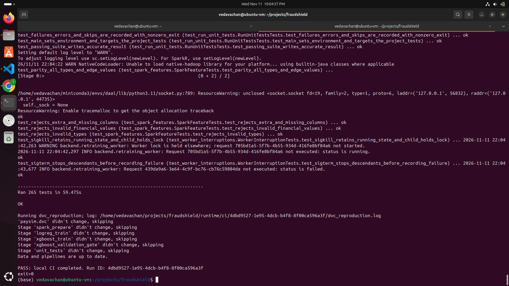 | Terminal output of the CI run executing the unit tests |
| `docs/evidence/2_dvc_status_dag.png` | 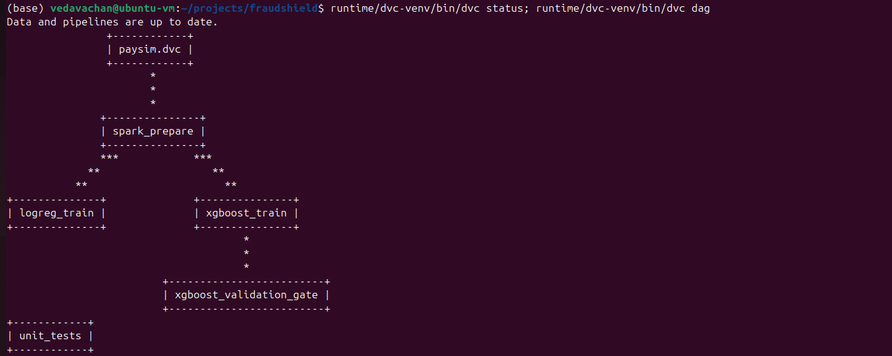 | `dvc status` and the pipeline DAG |
| `docs/evidence/3_dvc_metrics.png` | 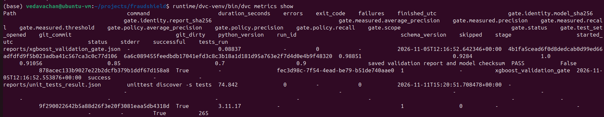 | DVC metrics output |
| `docs/evidence/5_compose_ps.png` | 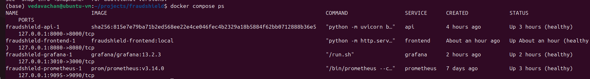 | `docker compose ps` listing the running services |
| `docs/evidence/6_docker_images.png` | 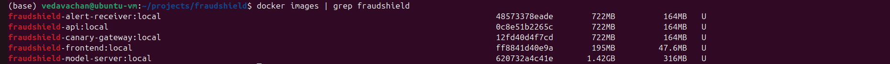 | `docker images` listing the built images |
| `docs/evidence/7_api_health.png` | 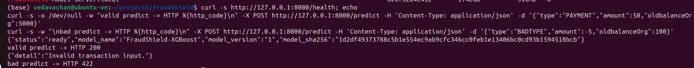 | API `/health` response |
| `docs/evidence/8_api_docs.png` | 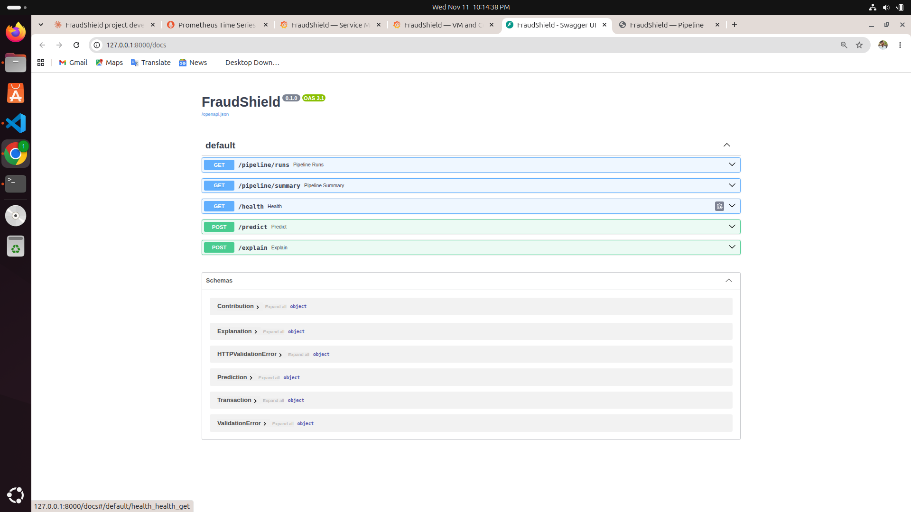 | API interactive documentation page |
| `docs/evidence/9_ui_landing.png` | 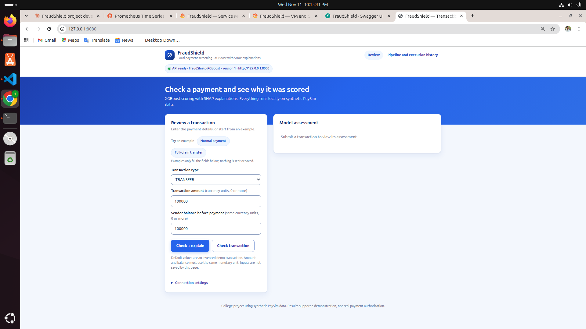 | Transaction page on first load |
| `docs/evidence/10_ui_normal.png` | 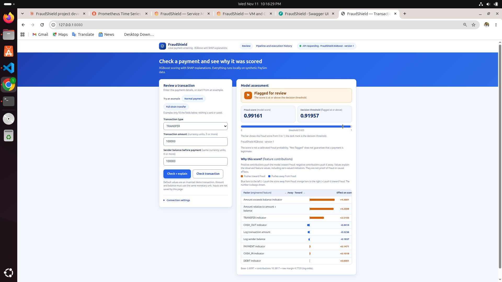 | Meant to show a normal payment, but it actually shows the same flagged TRANSFER result as 11 (score 0.99161). A real normal-payment screenshot is still missing |
| `docs/evidence/11_ui_fraud.png` | 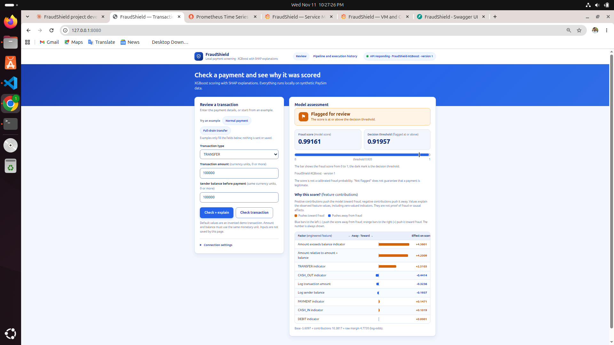 | Transaction page with a flagged (fraud) result |
| `docs/evidence/12_ui_invalid.png` | 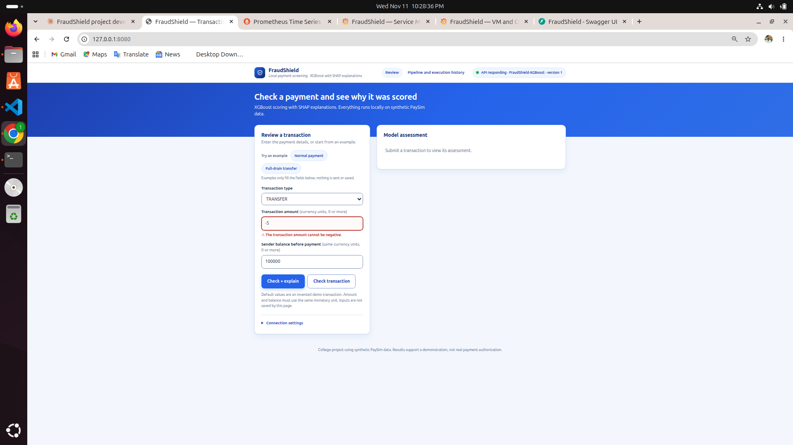 | Transaction page showing input validation errors |
| `docs/evidence/13_ui_pipeline.png` | 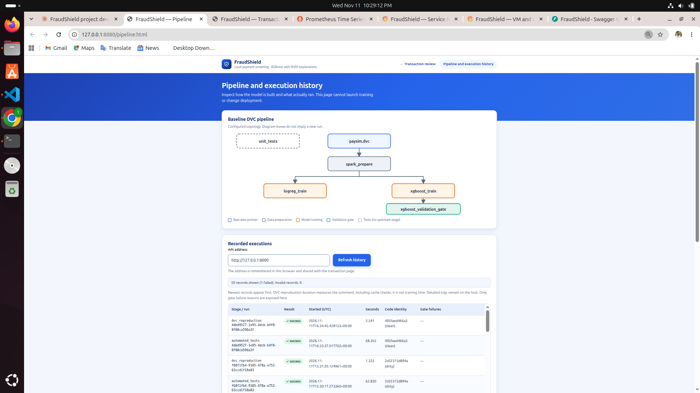 | Pipeline page with the DVC diagram and execution history |
| `docs/evidence/14_prometheus_targets.png` | 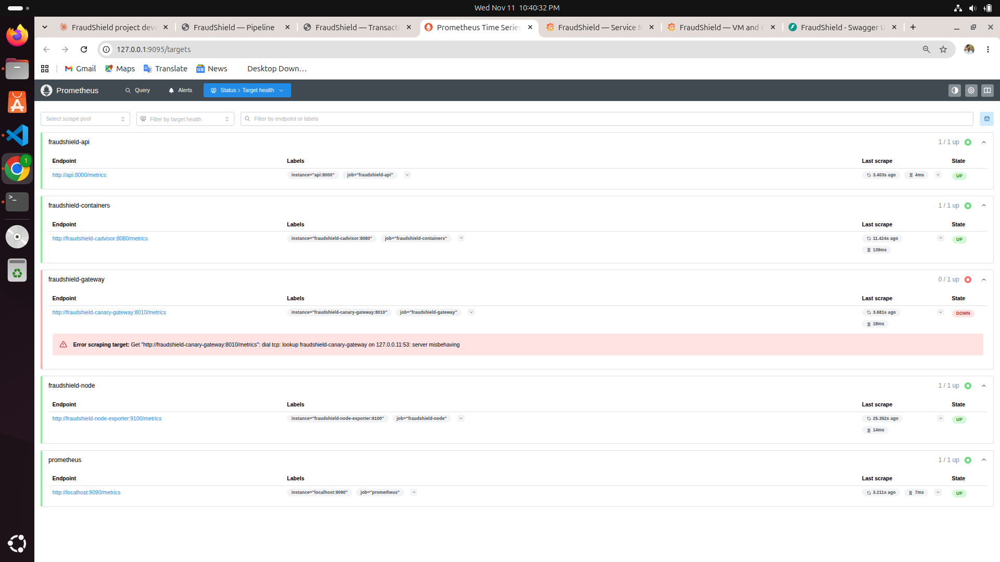 | Prometheus targets page |
| `docs/evidence/15_prometheus_query.png` | 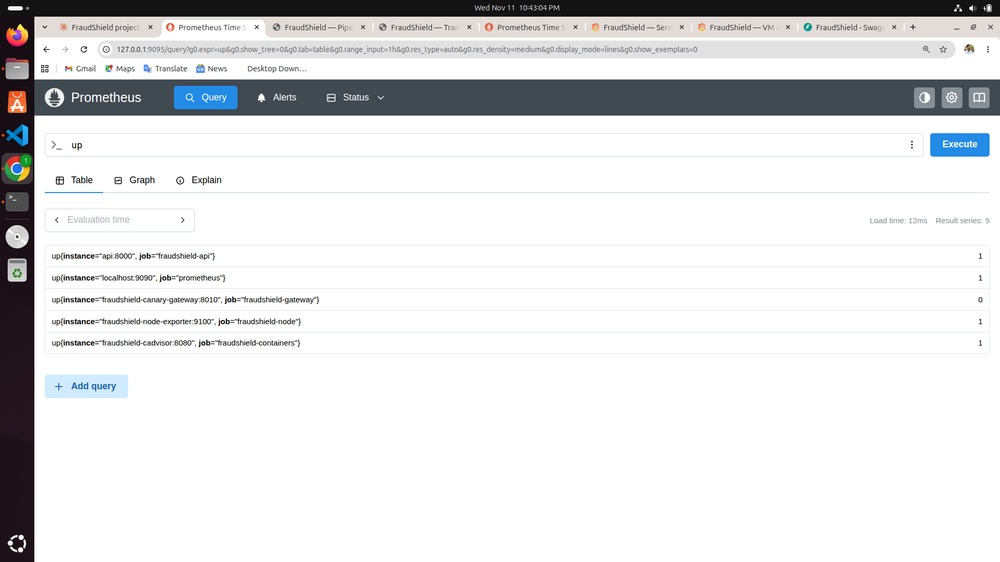 | A Prometheus query result |
| `docs/evidence/16_grafana_service.png` | 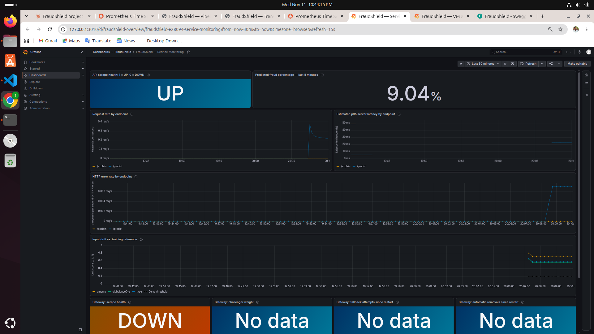 | Grafana service monitoring dashboard |
| `docs/evidence/17_grafana_resources.png` | 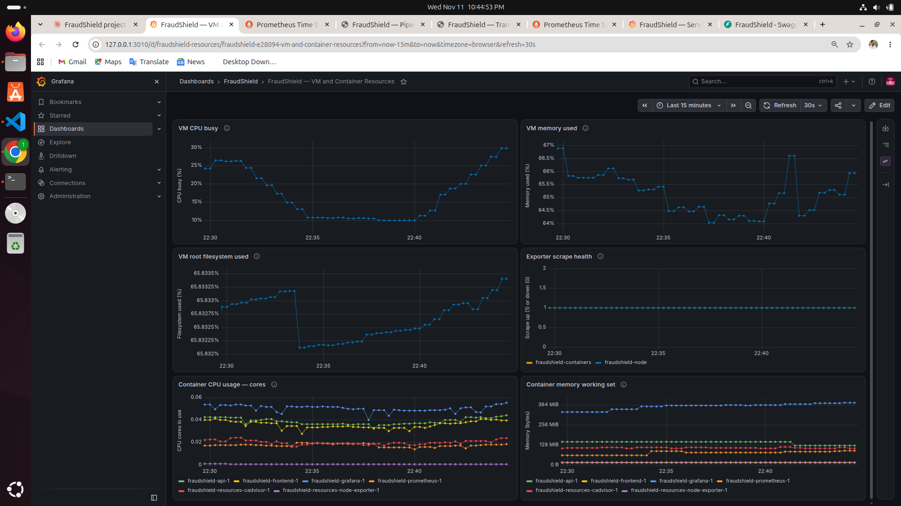 | Grafana VM and container resources dashboard |
| `docs/evidence/18_grafana_datasource.png` | 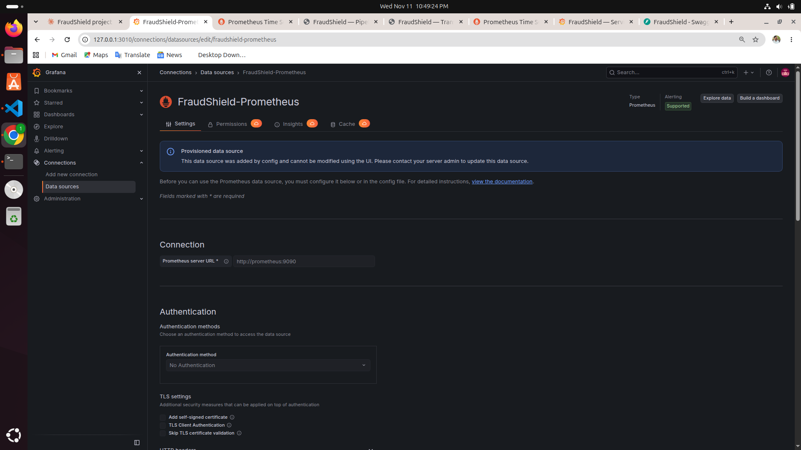 | Grafana Prometheus data source settings |
| `docs/evidence/19_mlflow_runs.png` | 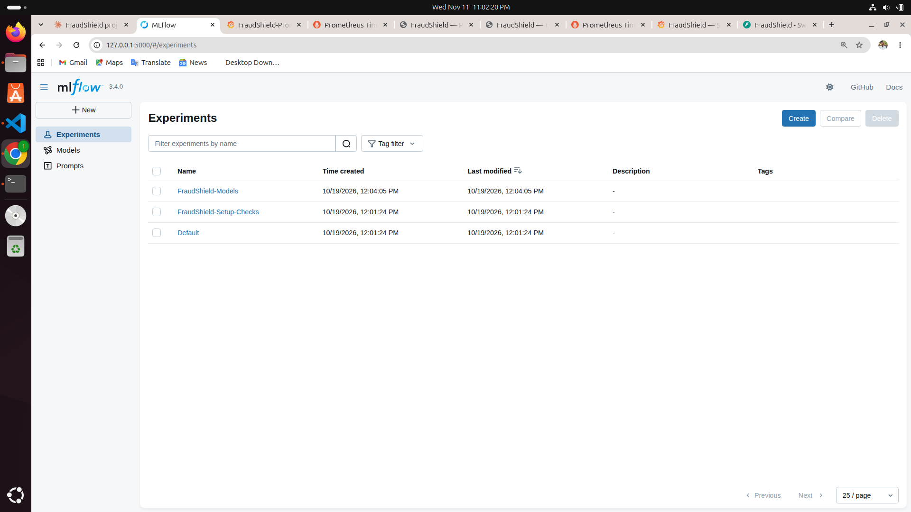 | MLflow experiment runs list |
| `docs/evidence/20_mlflow_run_detail.png` | 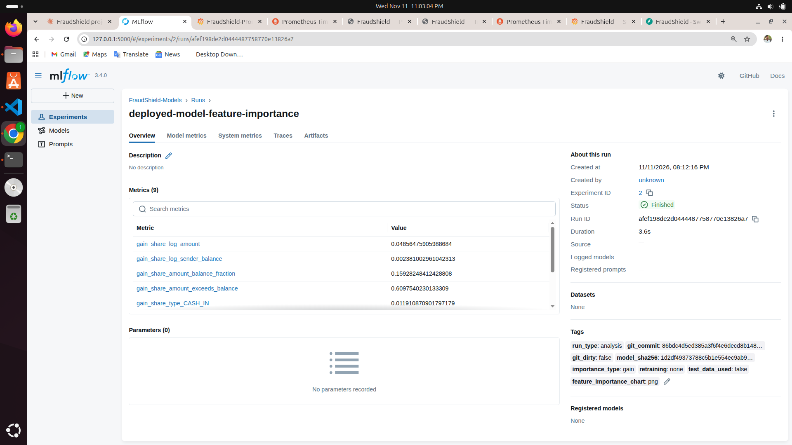 | MLflow run detail page |
| `docs/evidence/21_mlflow_models.png` | 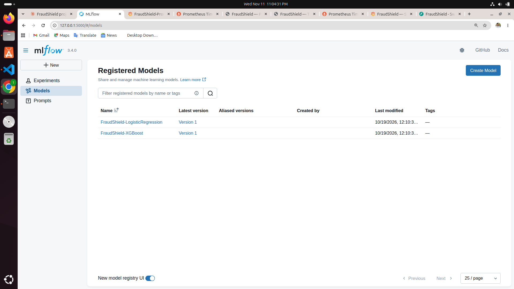 | MLflow registered models page |
| `docs/evidence/22_promote_dry_run.png` | 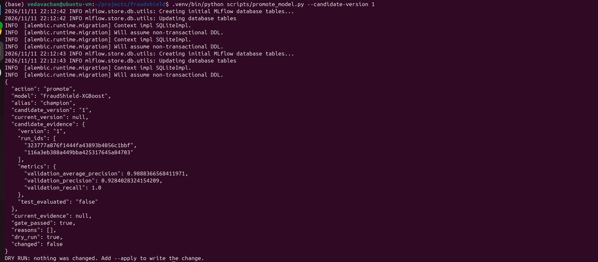 | `promote_model.py` dry-run output |

## Older results (110 tests)

### The recorded 110-test run

The full CI run at revision `c3c9d08` (run `4856995d-5df5-4c06-8937-f43f2427bcfa`) passed 110
tests in 87.739 seconds, followed by a successful DVC reproduction. The evidence is
`reports/retraining_ci/execution.json` plus `automated_tests.log` and `dvc_reproduction.log` in
the same folder. DVC skipped stages that hadn't changed, so this shows the command worked and
the cache was current, not a fresh training run. After that I checked the extra diagnostic
logging with the nine focused model-client tests, and the frontend changes by hand.

| Suite | Passing tests |
|---|---:|
| Alert receiver | 8 |
| API | 6 |
| Canary router | 10 |
| Canary rollback | 7 |
| Drift scanner | 6 |
| Shared features | 6 |
| Gateway | 12 |
| Gateway metrics | 6 |
| API metrics | 3 |
| Model client | 9 |
| Model gate | 6 |
| Pipeline history | 6 |
| Pipeline summary | 3 |
| Retraining queue | 9 |
| Retraining worker | 9 |
| Spark features | 4 |
| **Total** | **110** |

The output had deprecation and resource warnings even though every assertion passed, so it
wasn't a warning-free run.

Later, at revision `187fb3a`, CI run `bb6af575-7e9a-48a7-8046-aab57336728f` passed all 110 tests
in 33.637 seconds, with DVC skipping unchanged stages (`reports/final_ci/`). MLflow also built
the Conda environment declared in the `MLproject` and ran the gate and all 110 tests there
(28.363 seconds, no failures; `reports/mlproject_environment_verification.json`). That
configuration was committed as `e789920`. CI and DVC still use their own environments, and Java
on the host is still needed. This checks the test and gate environment, not a full fresh-machine
setup.

## Drills

| Check | Recorded outcome | Evidence |
|---|---|---|
| HTTP model serving | Three checked inputs agreed with the expected scoring path | `reports/mlflow_http_verification.json` |
| Local gateway failure | Failed challenger fell back once; weight became zero; next request used champion | `reports/gateway_http_drill.json` |
| Container canary | Both routes scored; stopped challenger triggered removal; challenger was restarted with weight remaining zero | `reports/compose_canary_drill.json` |
| Prometheus integration | Gateway target was up and exported prediction/routing metrics | `reports/gateway_metrics_ci/scrape_verification.json` and `metrics_snapshot.txt` |
| Alert delivery | Firing and resolved notifications reached the local receiver; original drift rules restored | `reports/alert_delivery_verification.json` |
| Real drift request | Shifted traffic delivered a drift notification and queued one request; recovery inputs restored low marginal drift | `reports/drift_request_drill.json` |
| Controlled training | Candidate training and validation gate succeeded; candidate checksum and terminal queue state verified | `reports/controlled_retraining_drill/` |
| Recovery and replay | Resolved notification received; completed request refused replay without changing its training log | `reports/controlled_retraining_drill/recovery_and_replay.json` |

My first attempt at a synthetic "resolved" alert timed out after I'd removed its rule. The
repeat kept the rule and switched its condition to false, and that worked. The later success
doesn't make the first attempt a success.

### The retrained candidate

Request `418aa34f-fc6b-4228-9a26-f59be1879c26` produced MLflow run
`6354dedb1a8f4360b22553f9e147fa06`, with candidate SHA-256
`cb69091fce02570dd1fe85add2dd67caee400cc81633e3d62ac9d4ffddd27f66`. Training and the gate both
exited with 0, and the worker took about 202 seconds. The served model didn't change and the
challenger weight stayed at zero. The candidate wasn't registered or promoted. It was trained on
the same training and validation data as before, so it doesn't show that retraining improved
accuracy or fixed drift.

## Checking the frontend by hand

| Case | What I saw |
|---|---|
| U01 default connection and assessment | "API ready", then a prediction and an explanation |
| U02 `http://localhost:8000` | The page showed "API ready" |
| U03 address kept after reload | After applying `http://localhost:8000` and reloading, the address was still selected and the header said "API ready"; `/health` and `/docs` loaded too |
| U04 unused port 8999 | The page showed the API as unavailable and cleared the old result |
| U05 restore default | Back to a ready API |
| U06 `http://example.com:8000` | Rejected; the previous address stayed active |

The negative-amount message from U08 shows in screenshot 12. The rest of U07 to U10 (behaviour
added on 10 November) haven't been run in a browser. These were manual checks, not automated
browser tests. Opening `http://127.0.0.1:8000` on its own returns `{"detail":"Not Found"}`,
which is expected because the page is on port 8080.

## Load tests in short

The full table and method are in the [load-test report](load_test_report.md), with checksums
in `reports/load_test_summary.json`. The direct API had no failed requests at 1, 4 or 8 clients.
The gateway's first attempt failed in warm-up with HTTP 503, and a later run had 16 failures
out of 1,000 at four clients (1.6%) and stopped before eight clients. After I added diagnostics
and recreated the gateway, later four- and eight-client runs had no failures and no upstream
errors in the logs, without any timeout increase. I still don't know what caused the earlier
503s, and the diagnostics aren't a fix. The eight-client explanation run had a maximum latency
of 4,904 ms despite no failures. None of this shows a sustained request rate, 50 users at once,
a capacity limit or an SLA.

## What still isn't checked

- Rebuilding from a fresh clone and getting the same metrics (AC-11).
- A 50-user load test (AC-07).
- Held-out results for the served model and for logistic regression (AC-05).
- U07 to U10 in a real browser, apart from the negative-amount message.
- Fresh-machine setup, and the course's real acceptance criteria.

Old test counts and later clean load runs don't settle the earlier gateway failures. A ready
container and a matching threshold also don't prove which model file answered each request.
