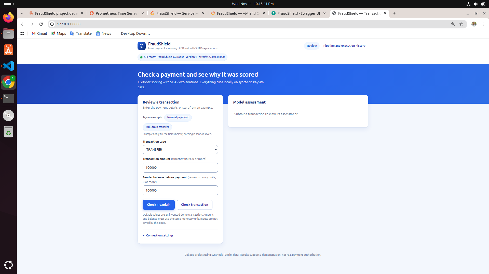
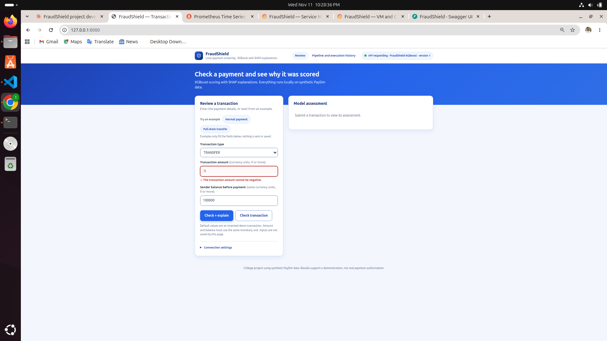
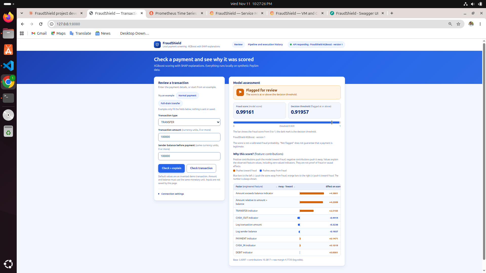

# FraudShield user manual

This is for anyone using the FraudShield web page. You don't need a technical background.
If something on the page breaks and nothing here helps, ask whoever runs the system; their
guide is [operator_guide.md](operator_guide.md).

## What it does

You enter one payment and FraudShield gives it a fraud score. A high score means the
payment looks like the fraud cases in the practice data the model learned from. If the
score is high enough, the page says the payment is "Flagged for review", meaning a person
should take a closer look.

A few things to keep in mind:

- This is a college project built on invented (synthetic) payments. It doesn't approve or
  block any real payment.
- A flag is a reason to check, not proof of fraud.
- "Not flagged" doesn't mean the payment is definitely fine.

## Opening the page

On the machine where the system runs, open `http://127.0.0.1:8080` in a browser (if you're
somewhere else, ask the operator for the address). Near the top there is a small status
line. When everything works it says "API ready", followed by the model name and version.

If it says "API unavailable" or "API is not ready", skip to
[If something doesn't work](#if-something-doesnt-work).

## Checking a payment

The "Review a transaction" card has three fields:

- **Transaction type**: one of TRANSFER, CASH_OUT, PAYMENT, CASH_IN or DEBIT. These are the
  types that exist in the practice data.
- **Transaction amount**: how much the payment is for, zero or more (for example `100000`).
- **Sender balance before payment**: how much the sender had before paying, in the same
  currency unit as the amount, zero or more.

The values already filled in are a made-up example, so change them as you like. The two
"Try an example" buttons ("Normal payment" and "Full-drain transfer") just fill the fields
in for you; nothing is sent until you press a check button. The page doesn't save what you
type.

Then press one of the two buttons:

- **Check transaction** gives you the verdict and the score.
- **Check + explain** does the same and also shows what pushed the score up or down.

If a field is empty, negative or not a number, a short red message appears under it, such
as "The transaction amount cannot be negative." Nothing is sent until every field is valid.

## Reading the result

The "Model assessment" card shows:

- **Flagged for review** or **Not flagged by the model**. The words say it, so you don't need
  to rely on the colour.
- **Fraud score** (model score): a number from 0 to 1. Higher means more like the fraud
  examples. It is not a percentage chance of fraud, and the page says so: "The score is not
  a calibrated fraud probability."
- **Decision threshold** (flagged at or above): the score is compared with this number. At
  or above it, the payment is flagged.
- A bar showing the score from 0 to 1, with a dark mark where the threshold is.
- The name and version of the model that produced the result.

### "Why this score?"

After "Check + explain" you also get a list of factors, the things about the payment that
the model looks at, each with an "Effect on score":

- A positive number (orange bar to the right) pushed the score towards fraud.
- A negative number (blue bar to the left) pushed it away from fraud.
- The bigger the number, ignoring the sign, the bigger the push. The biggest ones come first.

This shows how the model arrived at its score. It doesn't prove why a payment is fraud,
and it isn't cause and effect in the real world. A factor can still have an effect when it
is "off", for example the indicator for a transaction type that doesn't apply.

The small line under the table starting with "Base" is a technical check that the pushes
add up to the model's raw output. You can ignore it.

| Factor on the page | What it means |
|---|---|
| Log transaction amount | The size of the amount, scaled so very large amounts can be compared |
| Log sender balance | The size of the sender's balance, scaled the same way |
| Amount relative to amount + balance | The amount as a share of amount plus balance |
| Amount exceeds balance indicator | Whether the amount is bigger than the balance |
| TRANSFER / CASH_OUT / PAYMENT / CASH_IN / DEBIT indicator | Whether the payment is of that type |

## Messages you might see

| Message | What it means | What to do |
|---|---|---|
| Checking API… / Checking API · (address) | The page is asking the system if it's ready | Wait a moment |
| API ready · (model) · version (n) · (address) | The system is running with a model loaded | Nothing, go ahead |
| API is not ready · (address) | The system answered but is still starting | Wait a minute and reload; if it stays, tell the operator |
| API unavailable · (address) — check the address and backend | The page can't reach the system | Check the address (below); if it's right, tell the operator |
| API responding · (model) · version (n) | A check just worked | Nothing |
| Submit a transaction to view its assessment. | No result yet | Fill in the form and press a button |
| Checking… | The result is being worked out | Wait |
| Calculating explanation… | The explanation is being worked out, which takes a bit longer | Wait |
| Flagged for review | The score is at or above the threshold | Have someone look at the payment |
| Not flagged by the model | The score is below the threshold | Nothing, but it's not a guarantee |
| Enter the transaction amount. / Enter the sender balance. | A field is empty | Type a number |
| Enter the (field) as a number, for example 100000. | The field isn't a number | Type digits only |
| The (field) must be a finite number. | The number can't be used | Type an ordinary number |
| The (field) cannot be negative. | You typed a negative number | Use zero or more |
| Enter finite numerical amounts. | The amount or balance can't be used | Fix both numbers |
| Invalid input. Check the type, amount, and balance. | The system rejected the values | Check all three fields |
| Request timed out. Check the backend and try again. | The system took too long | Try again; if it keeps happening, tell the operator |
| Cannot reach the API. Check the backend and browser connection. | The page couldn't connect at all | Check the address and tell the operator |
| API request failed (HTTP number). | The system reported an error | Try again; if it repeats, give the operator the number |
| API address applied and saved in this browser. | Your new address was accepted | Nothing |
| API address applied for this page; browser storage is unavailable. | The address works now but won't be remembered | Nothing, or enter it again next time |
| Enter a complete local API address, such as http://127.0.0.1:8000. | The address isn't complete | Type it in full, starting with http:// |
| Use an HTTP or HTTPS localhost address with an optional port, without credentials, a path, query or fragment. | That address isn't allowed | Use the form http://127.0.0.1:8000 |

## Changing the connection address

You normally never need this. If the operator gives you a different address, open
"Connection settings" at the bottom of the form card:

1. Type the address into "Local API address", in the form `http://127.0.0.1:8000` (the
   number after the colon may be different).
2. Press "Apply and check connection". The browser remembers it for next time.
3. "Restore default" takes you back to `http://127.0.0.1:8000`.

Only addresses on the same machine (`localhost` or `127.0.0.1`) work, with no user name,
password or extra path. This only changes where the page sends its requests; the address
in your browser's address bar stays the same.

## If something doesn't work

1. Reload the page and wait for "API ready".
2. Check the address under "Connection settings". If you're not sure, press "Restore default".
3. Try the example payment that's already filled in.
4. Still stuck? Tell the operator exactly what message the page shows. They can check the
   system with [operator_guide.md](operator_guide.md).

## Questions people ask

**Is a flagged payment fraud?** Not necessarily. It means "worth a closer look".

**Is an unflagged payment safe?** Not guaranteed. The model can be wrong, and it only sees the
type, the amount and the balance.

**Does the page keep what I type?** No. Only the connection address is remembered in your
browser. The page says "Inputs are not saved by this page."

**Why does it look at so little?** It only gets the three fields on the form. Things like names
or account numbers are deliberately left out.

**Can I use real customer data?** No. It was built and tested on synthetic data and is only a
demonstration.

**Which model gave this result?** Its name and version are shown under the result.

## Words used on the page

| Word | Meaning |
|---|---|
| Fraud score | A number from 0 to 1; higher means more like the fraud examples |
| Decision threshold | The score at or above which a payment gets flagged |
| Flagged for review | The score reached the threshold, so someone should check the payment |
| Factor (feature) | Something about the payment that the model uses, like the amount |
| Effect on score (contribution) | How much a factor pushed the score up (+) or down (−) |
| Log-odds / SHAP | The technical unit and method behind the effects; safe to ignore |
| Model | The program that works out the score from past examples |
| Synthetic data | Made-up example payments, not real customers |
| API | The part of the system the page talks to; "API unavailable" means the page can't reach it |
| Operator | The person who runs and looks after the system |
